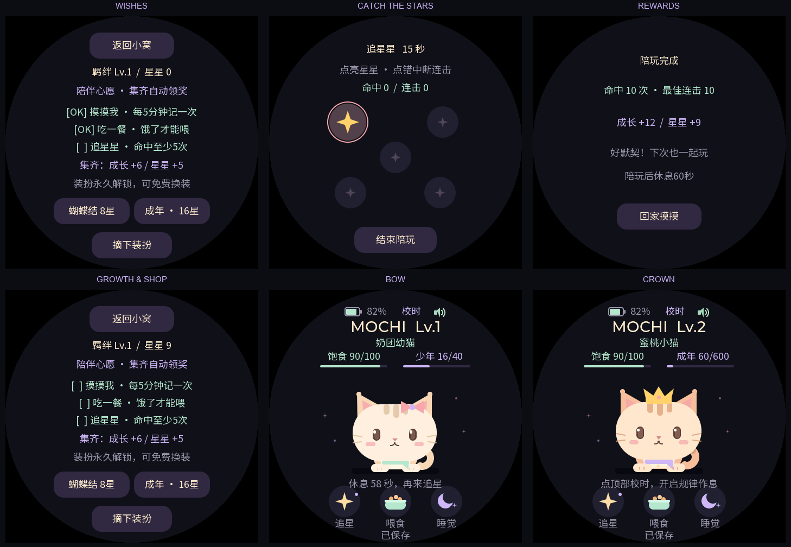
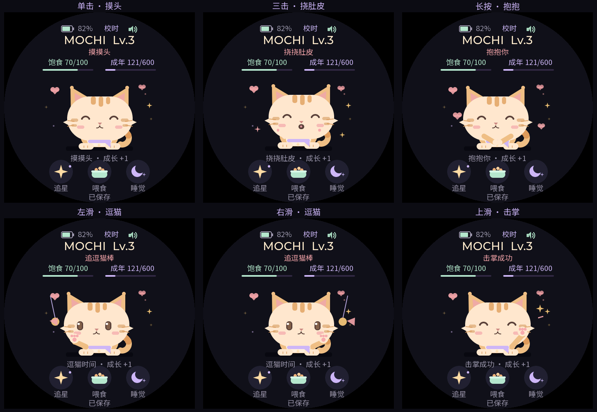
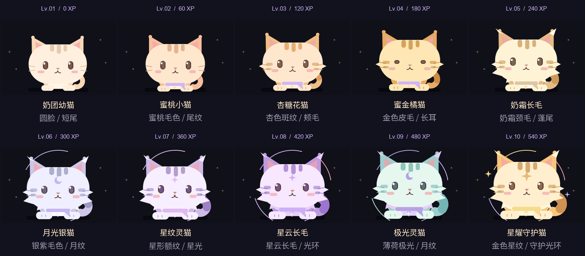
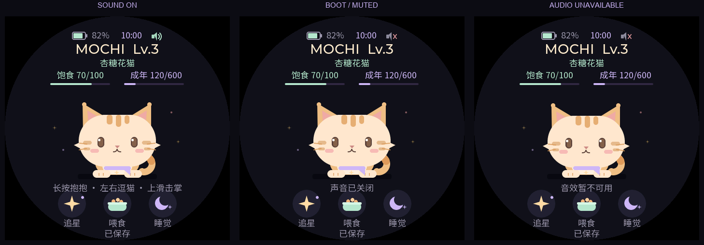
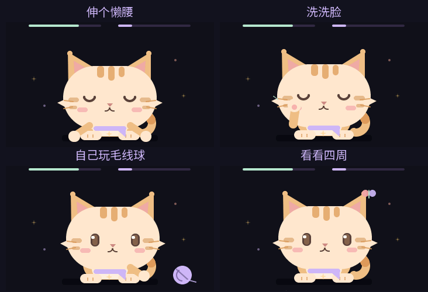
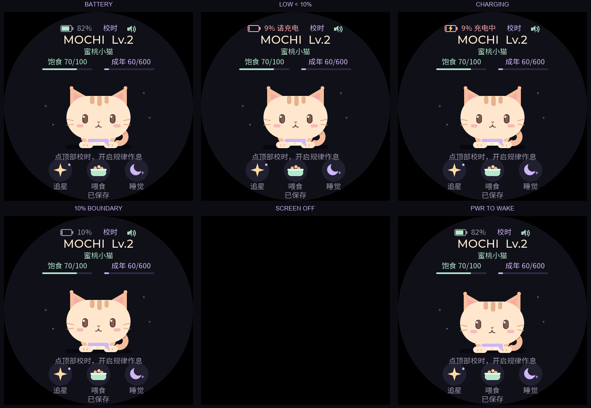

# MOCHI 口袋伙伴 — 触屏养成游戏 0.8.1

一只住在圆形 AMOLED 里的小猫。摸摸它、抱抱它，陪它追星星，看它从奶团幼猫成长为星耀守护猫。

面向 **Waveshare ESP32-S3-Touch-AMOLED-1.75C** 的离线触屏养成游戏，使用 ESP-IDF 5.5.5、官方 BSP 3.0.0 和 LVGL 9.5.0，适配 466×466 圆屏、32MB Flash / 8MB PSRAM。其他 ESP32-S3 开发板需要重新适配屏幕、触摸、电源和音频引脚，不能直接刷写本固件。

- **摸得到的陪伴**：单击摸头、三击挠肚皮、长按抱抱、左右逗猫、上滑击掌，配合原创合成声音。
- **看得见的成长**：十级独立形象、永久装扮、可循环陪伴心愿与15秒追星小游戏。
- **有自己的日常**：夜间睡眠、午休、每日小幅变化的作息，以及洗脸、伸懒腰、拨球和追看蝴蝶。
- **放下也在长大**：物理 PWR 熄屏进入 Light-sleep，继续缓慢成长和消耗饱食；BOOT 独立控制声音。
- **轻松养成**：不会饿死、退化或因断签失去进度，核心玩法不依赖网络、手机或云端服务。

[完整玩法](docs/gameplay-logic.md) · [刷机指南](docs/flashing.md) · [验证记录](docs/verification.md) · [许可与第三方声明](NOTICE.md)

当前版本 **0.8.1** 已刷入实机，用户确认声音正常且 BOOT 能开关。实际休眠电流、续航、RTC 长期漂移及长期稳定性仍待专项测量。预览图由固件共用代码渲染，不是实机照片。



## 操作与玩法

完整操作、数值、成长进化、心愿、作息、声音及熄屏存档规则见 [完整玩法与逻辑说明](docs/gameplay-logic.md)。

| 操作 | 效果 |
|---|---|
| 短按物理BOOT键 | 开启/关闭声音，静音设置会保存；不改变屏幕开关 |
| 单击小猫 | 摸头、点头微笑 |
| 双击小猫 | 进入追星小游戏 |
| 三击小猫 | 挠肚皮，扭动大笑 |
| 长按小猫约0.65秒 | 抱抱、浮出爱心 |
| 在小猫区域左右滑 | 逗猫，小猫追着方向看并抬爪 |
| 在小猫区域上滑 | 举爪击掌 |
| 底部“喂食” | 饱食≤75时增加25饱食、4成长；吃饭中不能重复领取 |
| 底部“追星” | 开始15秒触摸小游戏，点击亮起的星星，命中后目标换位 |
| 底部“睡觉/叫醒” | 切换角色睡眠；摸摸也可唤醒 |
| 点击顶部时间 / 校时 | 设置北京时间的日期、小时和分钟 |
| 点击顶部 MOCHI 名称 | 查看羁绊、星星、陪伴心愿，购买和切换装扮 |

单击/双击会等待约320ms确认，三击不会同时触发前面的动作。亲昵手势共用5分钟陪伴奖励冷却，重复操作仍有不同动画。完整阈值、反馈和中断规则见 [触控互动说明](docs/touch-interactions.md)。



**追星星**：每局消耗5饱食，至少10饱食才可开始。点错断连击，命中之间至少间隔180毫秒。5–9次命中奖励3成长、2星星，10次及以上奖励6成长、4星星。超时统一结算一次，主动退出无奖励。完成或退出后休息60秒；冷却尚未结束会显示剩余秒数。

**陪伴心愿**：任意顺序完成一次有效摸摸、一次有效喂食和一局至少5次命中的游戏，自动奖励6成长、5星星，再开启下一轮。每项每轮只记一次。这是可重复目标，没有每日刷新或连续签到。第一轮从新宠物开始，摸摸、喂食、游戏加心愿共可获得14或17成长。

**形象随等级进化**：每升一级，小猫的体型、毛色、颊毛、尾纹和额头图案都会变化。10种形象依次为奶团幼猫、蜜桃小猫、杏糖花猫、蜜金橘猫、奶霜长毛、月光银猫、星纹灵猫、星云长毛、极光灵猫、星耀守护猫。升级时播放短暂星光，显示新形象名称；读取旧存档直接按原有等级显示对应形象。已购买装扮继续佩戴，跟随头部比例缩放。等级和成长门槛见 [形象设定](docs/appearance.md)。



**成长**：幼崽0–19、少年20–59、成年60起，阶段升级增加围巾和徽章。成年后仍可累计至600成长；羁绊等级为 `min(10, 1 + 成长 / 60)`，540成长达到10级。少年可花8星星买蝴蝶结，成年可花16星星买皇冠；永久解锁，免费换装或摘下，一次佩戴一件。

**时间养成**：初始饱食70，亮屏每5分钟饱食−1、每10分钟自然成长+1；熄屏每30分钟饱食−1、每60分钟自然成长+1。两种变化亮屏均快6倍，未满周期的进度在切换和存档时保留。饱食不会低于0，成长不会超过600；不会饿死或退化。角色睡觉动画与系统熄屏分开，亮屏播放睡觉动画仍按亮屏速率计算。


完整数值、交互规则和后续方向见 [游戏设计](docs/game-design.md)。

## 互动声音

摸头和逗猫有短喵音，挠肚皮有连续轻叫，抱抱有呼噜感音效，喂食有咀嚼声，击掌、追星命中、奖励和升级有不同提示音。音量固定为80档（音频峰值另有限制），默认开启。短按物理BOOT切换声音，主页显示喇叭/静音图标和中文提示；关闭后仍可正常互动、成长。

熄屏立即停止音效并关闭功放/I2S；熄屏时BOOT仍可切换设置，但不播放确认音，也不会亮屏。PWR继续单独控制屏幕。白天自主待机、夜间和午休自动变化不发声。完整规则与可试听的WAV见 [声音说明](docs/sound.md)。



## 作息与白天待机

校准时间后，小猫每天在21:45–22:15入睡、07:00–08:00起床；午休在13:00–13:15开始、13:45–14:00结束。每天略有变化，同一天不会反复随机。睡眠时可以临时叫醒陪伴10分钟，之后继续休息；吃饭或游戏会先完成再入睡。角色作息不自动开关屏幕。

白天亮屏停留主页，小猫闲置约12–25秒后随机伸懒腰、洗脸、拨毛线球或追看蝴蝶，每次约5秒，触摸立即打断并回应。白天取消原有60秒闲置自动睡觉。待机没有额外奖励或饱食消耗。

首次使用请点顶部“校时”，保存当前北京时间。芯片RTC在Light-sleep期间继续计时，完全断电后需要重新校准；没有可靠时间时先保留普通养成，不触发定时作息。详细规则见 [作息与待机说明](docs/routine.md)。



## 电量图标与物理熄屏

主页顶栏显示电池图标和百分比，图标填充反映剩余电量，充电时叠加闪电。电量**低于10%**时显示粉红色“请充电”；实际充电中显示“充电中”。未装电池和读取失败有独立提示，约每5秒刷新。

**短按侧面PWR键熄屏，再次短按PWR键亮屏。** 已移除屏幕上的熄屏按钮。熄屏时禁用触摸输入，触摸不会亮屏或操作游戏；亮屏后等待手指松开，避免误触。在成长页和小游戏中同样可用。

熄屏进入保留内存的Light-sleep，暂停CPU、LVGL线程和触摸处理，每500ms短暂检查PWR并按真实经过时间补算角色数值。休眠每5分钟保存，亮屏后恢复30秒自动保存；等待保存或休眠失败会请求恢复显示。常态PWR响应约半秒。详见 [低功耗与时间养成](docs/low-power.md) 及 [电量/按键说明](docs/power.md)。



## 存档与升级

主页底部显示“保存中 / 已保存 / 存档异常”。动作与重要数值变化请求保存，后台约1秒合并写入，亮屏每30秒、休眠每5分钟保存累计计时。断电前等到“已保存”；突然断电可能回到最近一次成功存档。

使用独立 `pet_nvs` 分区（0x610000，64KB），两份记录交替保存，含版本、CRC32和数值检查。新版v3记录仍为80字节，可读取0.3的48字节v1与0.4的80字节v2，保留已有数值并迁移饱食计时比例；新增自然成长计时从0开始。升级不擦除宠物存档，遇到无法读取的存档也不会自动清空。

小游戏局内目标和成绩不续存。开局扣饱食并预留75秒（15秒游戏+60秒休息）倒计时；中途重启从最近成功存档恢复剩余倒计时，未结算的局没有奖励。关机期间所有数值和冷却暂停，没有根据不可靠时钟猜测离线时长。新版存档写入后，0.4及更早固件不支持v3，回退前应保留备份。

## 编译与测试

```bash
bash tests/run.sh
bash scripts/build.sh
bash scripts/preview.sh
bash scripts/audio_preview.sh
python3 scripts/package.py
```

本机默认 ESP-IDF：`/Users/jincheng/esp/esp-idf-v5.5.5`，工具：`/Users/jincheng/esp/tools-venv/bin`。其他环境通过 `PET_IDF_PATH`、`PET_BUILD_TOOLS` 覆盖。预览需要 Pillow，可用 `PET_PREVIEW_PYTHON` 指定解释器。

测试包含 ASan/UBSan 模型与存档测试，以及真实 LVGL 指针事件驱动的界面集成测试。主机预览复用固件的状态机、绘图和中文字库；主机存储适配器是替代实现，不能代替真实 NVS 断电测试。验证详情见 [0.8.1验证记录](docs/verification.md)。

## 烧录

发行包 `dist/amoled-pet-game-0.8.1.zip` 包含源码、已编译固件、预览和 SHA256 校验清单。连接数据线并打开开发板电源，先查找实际串口：

```bash
bash scripts/device.sh list
bash scripts/device.sh inspect --port 实际串口
bash scripts/device.sh flash --port 实际串口 --baud 2000000 --build-dir build
```

将“实际串口”替换为列出的 `/dev/cu.usb...`。发行包使用 `--build-dir firmware`。辅助工具先读取并校验32MB完整Flash备份，再写启动器、分区表和应用三个区域；不会写 `pet_nvs`。不要全片擦除。备份保存在本地 `backups/`，不包含在发行包中。

未安装 ESP-IDF 时，可安装 Python 和 `esptool>=4.9,<5`，从发行包执行 `python3 scripts/device.py flash --port 实际串口 --baud 2000000 --build-dir firmware`。串口辅助工具当前面向 macOS。

## 工程结构与范围

- `main/pet_model.c`：明暗时间养成、饱食、阶段、羁绊、游戏结算、心愿、装扮和冷却。
- `main/pet_routine.c`：UTC+8日历作息、每日稳定的时间波动。
- `main/pet_save.c`：v1/v2兼容、v3编码、CRC32和范围校验。
- `main/pet_store.c`：独立NVS分区、双份存档、后台合并写入。
- `main/pet_device.c`、`main/pet_battery.c`：AXP2101电量、充电状态、Light-sleep协调、RTC系统时间和AMOLED显示适配。
- `main/pet_power_key.c`：PWR短按中断状态、启动清理和选择性W1C确认。
- `main/pet_audio.c`、`main/pet_sound.c`：非阻塞音效、ES8311播放、静音记忆和原创PCM合成。
- `main/pet_boot_key.c`：BOOT去抖、松手单次切换和上电按住保护。
- `main/pet_touch.c`：多击、长按、方向滑动、拖动排除及取消。
- `main/pet_ui.c`：中文界面、角色绘制、追星星、成长页和触摸事件。
- `main/pet_font.c`：当前文案专用中文字库；新增文案需更新源字体子集，再运行 `scripts/make_font.py`。
- `tests/`、`preview/`：逻辑测试、存档测试、同代码界面测试和渲染。

当前输入为触摸、PWR和BOOT键。体感、语音识别和联网尚未接入；0.8.1真实休眠功耗、帧率、续航和长期稳定性尚未测量。历史0.3测试见 [第三阶段实机记录](docs/hardware-phase3-2026-10-29.md)。源码与字体许可见 `NOTICE.md`。
