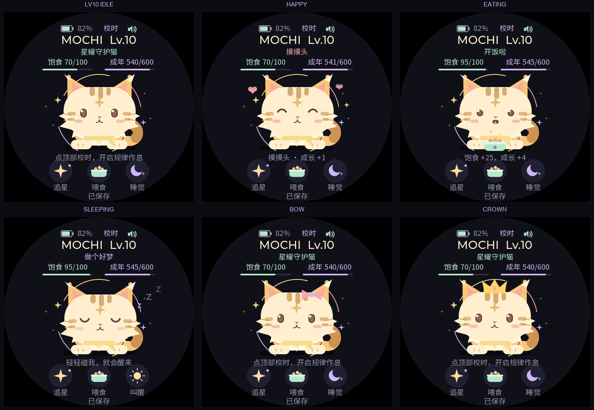

# MOCHI 0.4.1 形象设定

小猫随现有羁绊等级变化，每级获得独立的毛色、花纹与体型组合。圆脸、粉色耳朵、额头三道软纹和开心弯眼贯穿各级，使它一直是同一只 MOCHI。

| 等级 | 累计成长 | 形象名 | 主要变化 |
|---|---|---|---|
| Lv.1 | 0–59 | 奶团幼猫 | 奶油毛色、小身体、大圆脸、短尾，突出幼猫比例 |
| Lv.2 | 60–119 | 蜜桃小猫 | 毛色变蜜桃，身体和尾巴变大，出现第一道尾纹 |
| Lv.3 | 120–179 | 杏糖花猫 | 杏橘毛色、脸颊条纹、小簇颊毛、两道尾纹 |
| Lv.4 | 180–239 | 蜜金橘猫 | 更明显的金橘毛色，耳朵和身体长大，尾纹增多 |
| Lv.5 | 240–299 | 奶霜长毛 | 奶霜色胸毛、双层颊毛、耳尖簇毛和蓬松尾尖 |
| Lv.6 | 300–359 | 月光银猫 | 银紫色皮毛，月牙额纹，淡紫光弧 |
| Lv.7 | 360–419 | 星纹灵猫 | 紫色斑纹，星形额纹，星光配色 |
| Lv.8 | 420–479 | 星云长毛 | 更蓬松的颈毛、星云紫毛色和多层光弧 |
| Lv.9 | 480–539 | 极光灵猫 | 薄荷绿皮毛、银紫颈毛、月纹和极光色光弧 |
| Lv.10 | 540–600 | 星耀守护猫 | 金色长毛、星形额纹与紫色星芯、守护星光 |

形象由 `pet_model_level()` 直接推导，等级规则仍为 `min(10, 1 + 成长 / 60)`。Lv.1期间的幼崽/少年阶段仍保留原有围巾差异；20成长不会提前显示Lv.2。升至新等级时自动切换形象，播放2.8秒星光，并提示“进化啦！”和新形象名称。小游戏中升级时，回家后显示进化反馈。读取存档时直接显示对应形象，不重复播放升级反馈。

## 动画与装扮

每级均保留呼吸、眨眼、摇尾、开心跳跃、进食和睡眠。不同等级的身体与头部采用不同缩放比例，脚的位置保持稳定；高等级长毛、花纹和光弧按部位绘制。

已购买的蝴蝶结和皇冠继续可用，跟随头部位置与尺寸变化；与天生额纹可以同时显示。最高等级皇冠在开心跳跃、进食和睡眠中也单独渲染检查。升级不会花费星星，不改变装扮所有权。

## 实现与兼容

- 使用LVGL基础图形实时绘制，沿用本地代码美术，不依赖在线生成图片或额外大尺寸图片资源。
- 形象配置和绘制在 `main/pet_ui.c`，无需新增存档字段。
- 0.3/0.4旧存档继续由现有v1/v2解码读取，按原有成长值显示新形象。
- 预览使用与设备相同的绘图代码；成长值由主机测试构造，没有改写实物存档。
- 真实设备的显示效果、帧率和功耗仍需烧录后验证。
