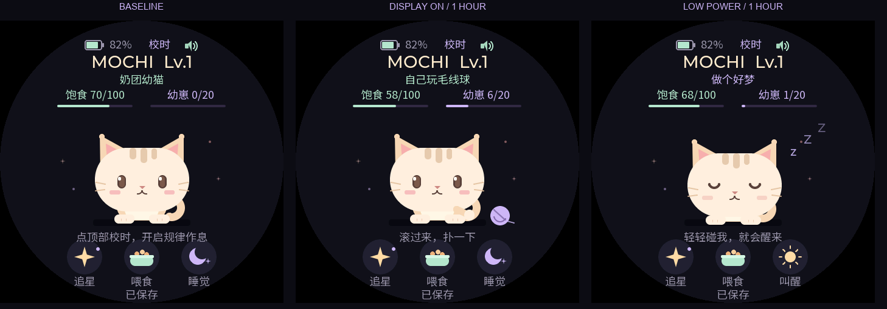

# 熄屏低功耗与时间养成 — 0.8.1

熄屏后，ESP32-S3进入保留RAM的Light-sleep。界面线程和LVGL毫秒定时器暂停，触摸继续禁用；角色按实际经过的时间消耗饱食、获得成长。PWR短按恢复原页面，保持亮屏前已有的游戏和装扮状态。

## 时间规则

| 显示状态 | 饱食自然下降 | 自然成长 | 每小时合计 |
|---|---|---|---|
| 亮屏 | 每5分钟−1 | 每10分钟+1 | 饱食−12、成长+6 |
| 熄屏低功耗 | 每30分钟−1 | 每60分钟+1 | 饱食−2、成长+1 |

亮屏的两种变化均为熄屏的6倍。数值仍限制在饱食0–100、成长0–600；饱食为0不会死亡或扣成长，自然成长仍继续。互动、小游戏和心愿奖励在自然成长之外保留原规则。

模式由真实屏幕状态决定。小猫在亮着的屏幕上播放睡觉动画时，仍按亮屏速率计算。频繁切换不会重置未满一周期的进度；例如亮屏4分钟再熄屏6分钟，恰好消耗1饱食。关掉整机或完全断电的时长仍不补算。

图中第三格是熄屏一小时后再按PWR亮屏的状态；主机测试构造时间，电量来自夹具。

## 低功耗控制

1. PWR事件在LVGL线程处理，将AMOLED亮度设为0、禁用触摸，并请求保存。
2. 电源线程从显示锁外暂停LVGL适配器；适配器同时停止其毫秒定时器。完成休眠前的最后一次计时并等待NVS提交。
3. 使用 `esp_light_sleep_start()` 和500ms定时唤醒。两个CPU在睡眠期间暂停，RAM保留；每次唤醒只短暂检查PWR锁存事件，并结算这段真实经过的时间，随后再次睡眠。
4. 休眠期间每5分钟请求一次后台存档，提交完成再睡；PWR亮屏前再保存一次。亮屏时仍采用原有30秒自动保存。
5. 收到PWR短按后，恢复LVGL线程，由原有显示锁保护的UI路径发送CO5300亮度命令。保留0.4.4修复，避免与显示刷新并发。

原理图中的AXP_IRQ没有连接到ESP32的GPIO，因此本版采用定时检查PMIC锁存事件，不能把它配置成PWR直接GPIO唤醒。常态按键响应约半秒，保存提交期间可能稍长。触摸不是唤醒源，亮屏后仍等待手指松开。

参考：[Waveshare原理图](https://files.waveshare.com/wiki/ESP32-S3-Touch-AMOLED-1.75C/ESP32-S3-Touch-AMOLED-1.75C-schematic.pdf)、[ESP-IDF 5.5.5睡眠模式](https://docs.espressif.com/projects/esp-idf/en/v5.5.5/esp32s3/api-reference/system/sleep_modes.html)。Light-sleep保留内存且对CPU/大部分数字外设门控；板上电源管理、存储保持和外部器件仍有消耗，不代表整机断电。

## 时间与存档

睡眠时间用 `esp_timer_get_time()` 的单调时间差结算；Light-sleep返回后的时间补偿由ESP-IDF完成。LVGL时钟暂停期间，模型另行补算时间并重新锚定，恢复时不会再扣一遍。小数毫秒和未满一周期的进度保留，长时间补算使用64位整数，避免32位时钟回绕和乘法溢出。

v3存档仍为80字节，新增自然成长的未满周期进度。读取v1/v2时保留原有数值，将旧饱食计时乘6转换为新基准，保持原本已走完的比例；自然成长计时从0开始，不补发升级前的成长。读档或保存失败不会擦除旧数据。写入v3后，旧0.4固件不支持v3；回退前需保留备份。

游戏局内时间也会经过。休眠跨过15秒期限时按已经获得的命中数结算一次，之后冷却继续经过；自然成长与游戏奖励分开显示，临近600成长上限时按实际时间先后结算。

## 声音与BOOT

0.8.0熄屏时先取消当前和排队音效，等待功放关闭、I2S TX停止及声音偏好写入完成，再进入Light-sleep。没有创建I2S RX或启用麦克风。

BOOT接GPIO0，低电平可临时唤醒CPU处理声音开关，不恢复LVGL、触摸或显示。按住期间每20ms检查去抖和释放，松开后回到低功耗；上电时已经按住的BOOT不会在首次释放时误切换。PWR仍是唯一的显示开关，触摸仍不能唤醒或操作熄屏界面。GPIO0唤醒路径与真实播放/停播后的耗电仍需上板验收。

## 日历作息

0.7.0在每次低功耗时间补算后检查RTC系统时间，按日历更新夜间/午休状态。角色在低功耗中起床也不会点亮屏幕或启用触摸。成长和饱食继续用单调经过时间计算，校时不会影响数值结算。RTC配置为RTC+高分辨率计时组合，完全断电后通过顶部时钟重新校准。详见 [作息与待机](routine.md)。

## 失败处理与验证边界

暂停界面、等待保存或进入休眠失败时，日志记录原因并请求恢复显示，不把普通黑屏当作休眠成功。日志中的 `Low power exit` 会给出成功睡眠循环次数和本段休息毫秒数。

模型和存档测试、真实LVGL界面事件测试及ESP-IDF构建已完成，详细记录见 [验证记录](verification.md)。包括明暗6倍率、一小时比较、500ms分段与整段一致、反复切换、时间重锚、长时间/上限、小游戏单次结算和v1/v2迁移。

0.7.0已刷写并通过启动、存档恢复和后台保存检查；低功耗实物交互尚未在本次验收。实际Light-sleep进入/退出、PWR恢复、USB连接影响、长期稳定性、电流和续航需设备验证；不能用主机预览推算实际省电比例。0.4.4的实机通过记录仅作为此前显示/按键功能的历史证据。
