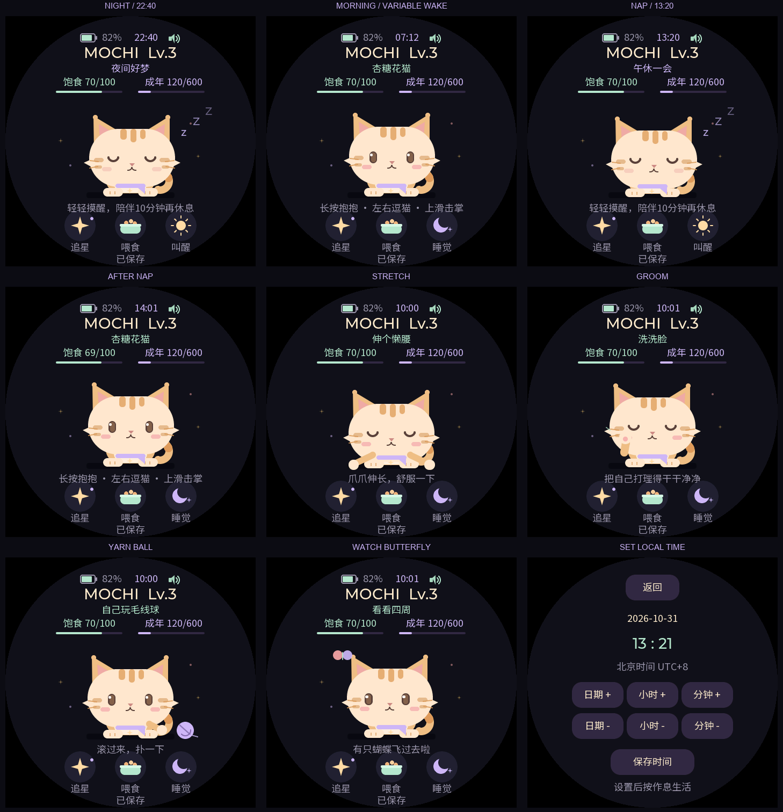

# 规律作息与白天待机 — 0.7.0

小猫使用北京时间（UTC+8），每天有轻微不同的作息。每天的时间由当地日历日期确定，同一天重启不会重新抽签。以当前日期为准，不依赖开机时刻，也不会把开机后22小时当作晚上22点。

| 作息 | 每天的时间范围 |
|---|---|
| 夜间入睡 | 21:45–22:15 |
| 早上起床 | 07:00–08:00 |
| 午休开始 | 13:00–13:15 |
| 午休结束 | 13:45–14:00 |

午休持续30–60分钟。入睡边界包含该分钟，起床边界立即结束睡眠；午夜保持夜间睡眠，并使用新一天的起床时间。只改变角色状态，屏幕的开关仍完全交给物理PWR键。

## 第一次校时

点击主页顶栏的“校时”，设置日期、小时、分钟，再点“保存时间”。已有时间时，点击顶栏的 `HH:MM` 可以重新校准。日期以天为单位加减，小时和分钟分别循环调整；保存时秒归零。时区固定为北京时间。

1.75C使用ESP32-S3的系统时钟和芯片RTC；本版没有Wi-Fi配网或联网校时。未校准时显示“校时”，不会按错误的日期触发夜间/午休，白天待机和原有玩法仍可使用。校准页初始值使用固件编译时间，只作为编辑起点，必须由用户保存才成为有效时钟。

配置使用 `CONFIG_LIBC_TIME_SYSCALL_USE_RTC_HRT=y`。Light-sleep期间RTC继续走时；软件复位可保留系统时间，完全切断供电后需要重新校时。内置RC时钟存在漂移，长期使用可以点击顶部时间调整。日历负责作息；饱食、成长和奖励冷却继续使用原有单调计时，校准时钟不会补发成长、跳过冷却或重复扣饱食。

参考：[1.75C原理图](https://files.waveshare.com/wiki/ESP32-S3-Touch-AMOLED-1.75C/ESP32-S3-Touch-AMOLED-1.75C-schematic.pdf)、[ESP-IDF 5.5.5系统时间](https://docs.espressif.com/projects/esp-idf/en/v5.5.5/esp32s3/api-reference/system/system_time.html)。

## 叫醒与优先级

- 夜间或午休可以摸摸、喂食、玩耍，或点击“叫醒”。小猫会临时清醒10分钟；有效照顾和开始游戏会重新计算这10分钟，之后继续原来的睡眠时段。
- 到入睡时间时，先完成当前进食和开心反馈，或当前15秒追星游戏，再睡觉。已经进入的成长页和结果页不被强制关闭。
- “睡觉”可以主动让角色休息；早晨起床或午休结束时恢复清醒。临时叫醒和手动睡觉属于本次运行状态，不修改v3存档结构。
- 亮屏白天不再因为60秒没有操作就睡觉。尚未校时且已经熄屏时，保留原有闲置60秒的休息姿态；它不影响屏幕开关或养成速率。
- 熄屏期间仍检查实际日历时间。小猫按时入睡、起床，显示和触摸继续关闭，只有PWR能恢复屏幕。
- 校时明显前跳或后跳会清除旧时钟上的临时叫醒期限，按新时间重新判断作息。

角色睡眠不改变养成倍率：亮屏仍每5分钟饱食−1、10分钟成长+1；熄屏仍每30分钟饱食−1、60分钟成长+1。完全断电期间仍不补算数值。

## 白天亮屏待机

在主页清醒、没有触控或小游戏时，小猫闲置约12–25秒后做一个5秒的小动作。四种动作伪随机选择，相邻两次不重复：

| 动作 | 可见变化 |
|---|---|
| 伸个懒腰 | 闭眼、低头、前爪伸长 |
| 洗洗脸 | 抬爪在脸颊前来回擦拭 |
| 自己玩毛线球 | 毛线球滚动，小猫跟着看并拨球 |
| 看看四周 | 蝴蝶摆动翅膀，小猫转头追看 |

触摸按下立即打断待机；随后按原有单/双/三击、长按、滑动规则处理。菜单、喂食、手动睡眠、游戏和熄屏同样会停止待机。夜间和午休临时叫醒期间不播放白天待机。待机动作不消耗额外饱食，不发放摸摸成长、星星或心愿进度；自然成长照常累计。

## 实现与验证

`pet_routine.c`是纯日历规则，`pet_model.c`处理作息、临时叫醒和待机状态，`pet_ui.c`绘制动画和时钟编辑页，`pet_device.c`封装系统时钟。休眠线程只更新模型，不发送显示亮度命令。

测试覆盖400天时间范围和边界、每日稳定/跨日变化、午夜、午休、叫醒期限、校时跳变、繁忙动作衔接、低功耗起床、四种动画、无额外奖励和触控中断。真实LVGL指针事件覆盖校时的日期/小时/分钟按钮与保存，另验证电量文字和时钟不重叠。主机夹具验证的日历/睡眠不能替代实机RTC漂移、断电重校和真实功耗验收，见[本版验证记录](verification.md)。
